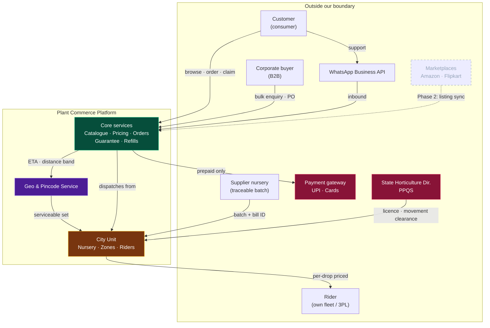
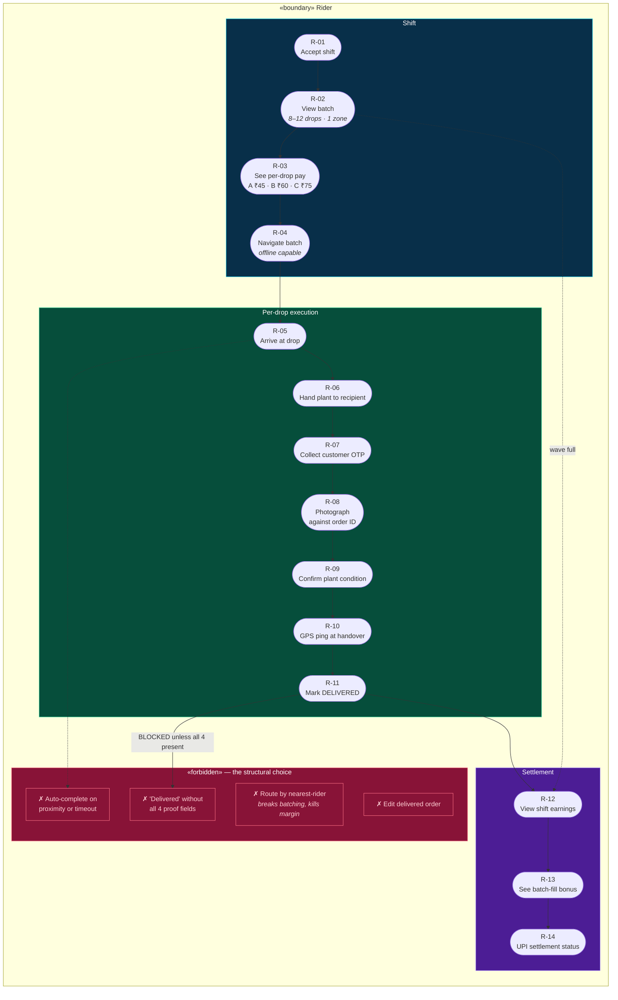
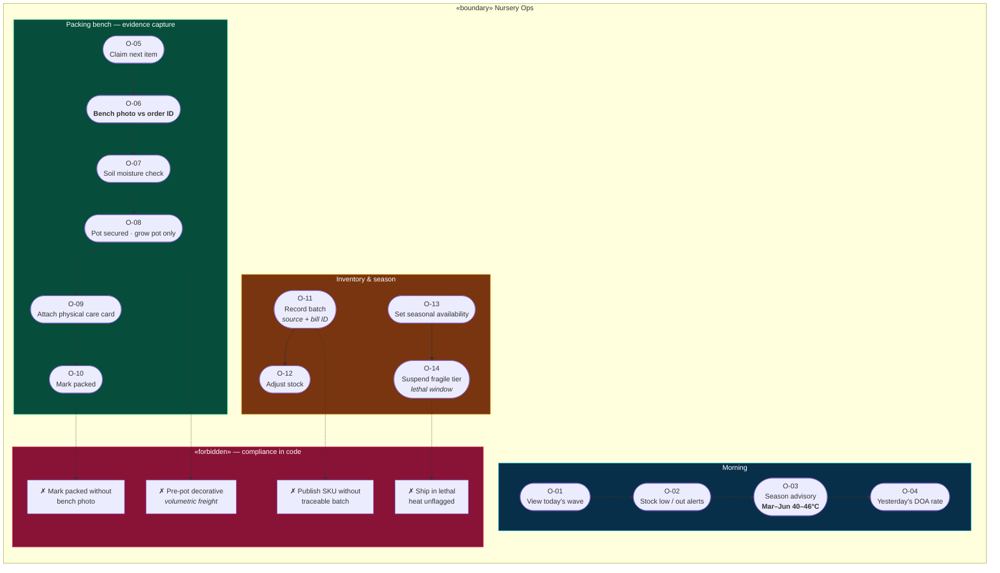
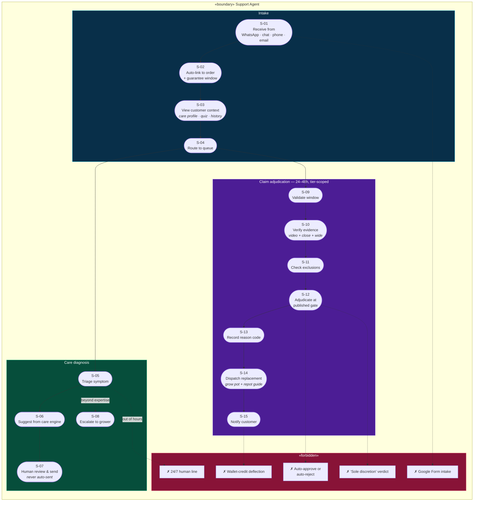
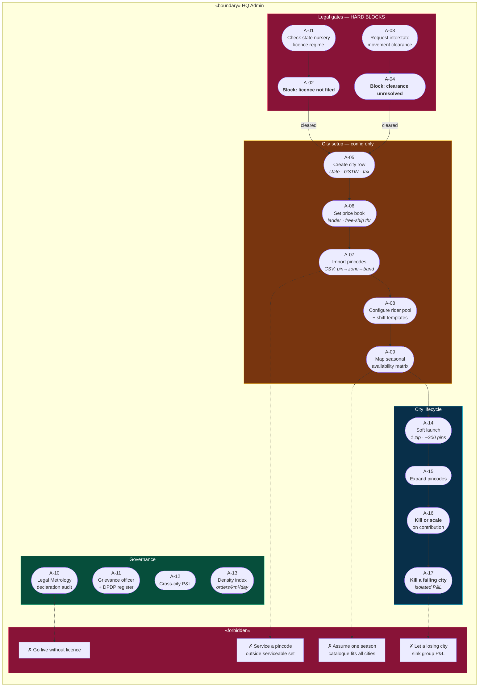
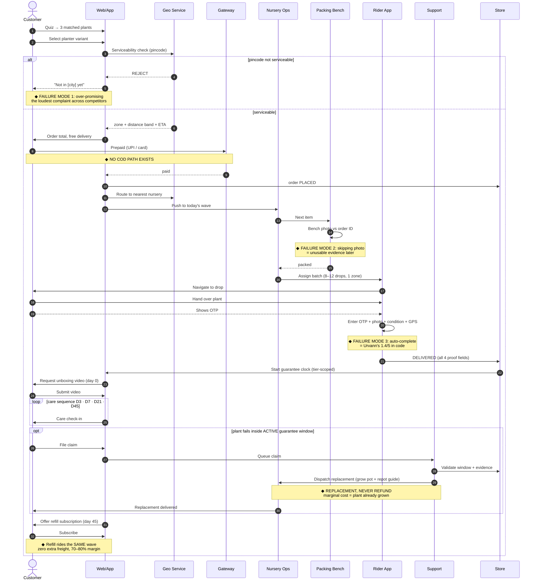
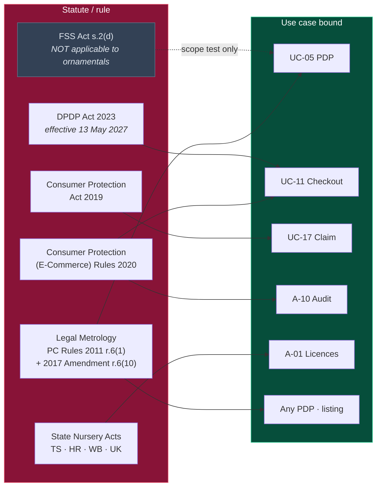
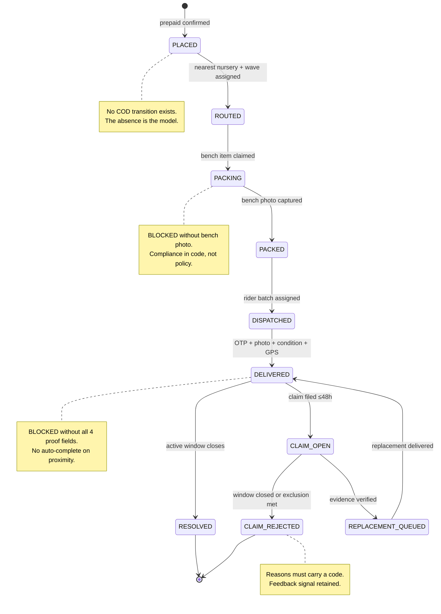
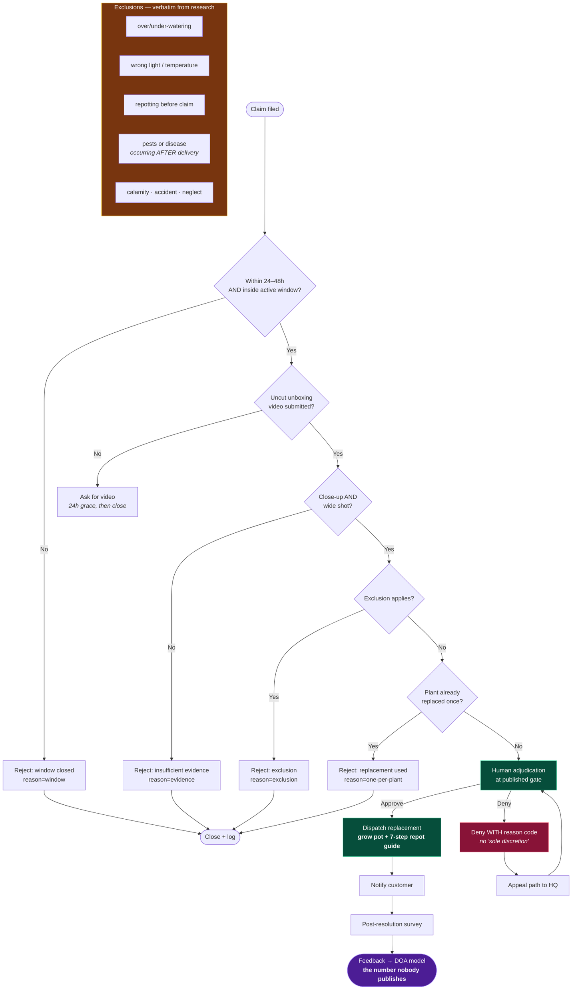

# Use Case Diagrams — Plant Commerce Platform

**Date:** 4 October 2026
**Companions:** `product-design.md`, `plant-platform-architecture.html`
**Format:** Mermaid. All diagrams below render in GitHub, GitLab, Obsidian, VS Code (Markdown Preview Mermaid Support), mermaid.live, and any `mermaid-cli` pipeline.

**Diagram index**

| #   | Diagram                     | Question it answers                                                         |
| --- | --------------------------- | --------------------------------------------------------------------------- |
| 1   | System context              | What sits outside our boundary?                                             |
| 2   | Customer use cases          | What can a customer do, and which are they _forbidden_ to do?               |
| 3   | Rider + delivery use cases  | How is delivery fraud structurally prevented?                               |
| 4   | Nursery ops use cases       | How is order integrity enforced at the bench?                               |
| 5   | Support use cases           | How is the guarantee adjudicated, at the tier we are actually offering?     |
| 6   | HQ admin use cases          | How does a new city get onboarded?                                          |
| 7   | Cross-surface order journey | How handoffs work, with failure modes                                       |
| 8   | Compliance obligations      | Which statute binds which use case                                          |
| 9   | State machine               | Where can an order legally be, and what blocks it                           |
| 10  | Guarantee adjudication      | The 24–48h replacement-only flow, plus the promotion gate to longer windows |

---

## 1. System context



**Boundary note:** the marketplace lane is Phase 2 and deliberately dashed. Our research found every marketplace gates on a GSTIN and runs its _own_ return window — which is precisely why Ugaoo's 30-day clock keeps running while the customer's marketplace window governs the actual claim. **We do not want that ambiguity. D2C is the primary channel; marketplaces are reach, not fulfilment.**

---

## 2. Customer — use cases

```mermaid
graph TB
    subgraph BOUND["«boundary» Customer"]
        direction TB

        subgraph DISC["Discovery"]
            UC1(["UC-01<br/>Take plant-finder quiz"])
            UC2(["UC-02<br/>Browse seasonal catalogue"])
            UC3(["UC-03<br/>Filter by room · light · pet-safe"])
            UC4(["UC-04<br/>Search by symptom<br/><i>symptom-first</i>"])
            UC5(["UC-05<br/>View PDP with<br/>Legal Metrology declarations"])
            UC6(["UC-06<br/>Read care content<br/><i>117 guides · 175 symptom pages</i>"])
        end

        subgraph PURCH["Purchase"]
            UC7(["UC-07<br/>Select planter variant<br/><i>primary AOV lever</i>"])
            UC8(["UC-08<br/>Add to cart"])
            UC9(["UC-09<br/>Check serviceability by pincode"])
            UC10(["UC-10<br/>Confirm care profile"])
            UC11(["UC-11<br/>Pay prepaid"])
            UC12(["UC-12<br/>Place order"])
        end

        subgraph POST["Post-purchase — the care &amp; guarantee surface"]
            UC13(["UC-13<br/>Track order"])
            UC14(["UC-14<br/>Submit unboxing video"])
            UC15(["UC-15<br/>Care check-ins<br/>D3 · D7 · D21 · D45"])
            UC16(["UC-16<br/>Diagnose problem"])
            UC17(["UC-17<br/>File damage claim"])
            UC18(["UC-18<br/>Receive replacement"])
            UC19(["UC-19<br/>Accept refill subscription"])
            UC20(["UC-20<br/>Rate &amp; review"])
        end

        subgraph REFUSE["«forbidden» — intentionally absent"]
            F1["✗ Cash on delivery"]
            F2["✗ Cancel after dispatch<br/><i>no return leg exists</i>"])
            F3["✗ Refund for plants<br/><i>replacement only</i>"]
            F4["✗ Return a plant<br/><i>non-saleable on return</i>"]
            F5["✗ Order to unserviceable pincode"]
            F6["✗ Claim outside<br/>active window<br/><i>tier-dependent</i>"]
            F7["✗ 2nd replacement<br/>on same plant"]
        end

        UC1 --> UC3
        UC3 --> UC5
        UC2 --> UC5
        UC4 --> UC6
        UC6 --> UC5
        UC5 --> UC7 --> UC8 --> UC9
        UC9 --> UC10 --> UC11 --> UC12
        UC12 --> UC13 --> UC14 --> UC15
        UC15 --> UC16
        UC16 --> UC17 --> UC18
        UC15 --> UC19
        UC18 --> UC20
        UC19 --> UC13
    end

    UC9 -.->|"pincode rejected"| F5
    UC17 -.->|"window closed"| F6
    UC17 -.->|"plant already replaced"| F7
    UC11 -.->|"COD not offered"| F1

    style DISC fill:#082f49,stroke:#22d3ee,color:#fff
    style PURCH fill:#064e3b,stroke:#34d399,color:#fff
    style POST fill:#4c1d95,stroke:#a78bfa,color:#fff
    style REFUSE fill:#881337,stroke:#fb7185,color:#fff
    style F1 fill:#881337,stroke:#fb7185,color:#fecdd3
    style F2 fill:#881337,stroke:#fb7185,color:#fecdd3
    style F3 fill:#881337,stroke:#fb7185,color:#fecdd3
    style F4 fill:#881337,stroke:#fb7185,color:#fecdd3
    style F5 fill:#881337,stroke:#fb7185,color:#fecdd3
    style F6 fill:#881337,stroke:#fb7185,color:#fecdd3
    style F7 fill:#881337,stroke:#fb7185,color:#fecdd3
```

### The seven refusals are features

Each maps to a researched failure:

| Refusal                             | Evidence                                                                                                                                                                           |
| ----------------------------------- | ---------------------------------------------------------------------------------------------------------------------------------------------------------------------------------- |
| **No COD**                          | Return leg is **25–30 days** vs 3–4 day forward; plant is **non-saleable on return**. A COD bounce is a total write-off. Samarth Cactus caps COD at ₹500–1,500 for the same reason |
| **No plant returns**                | Non-saleable in all three policies we examined. Ugaoo refuses outright; Paudhewale disposes of them "at the customer's end"                                                        |
| **Replacement, not refund**         | Marginal cost of a replacement is a plant already grown and otherwise discarded                                                                                                    |
| **Pincode gate**                    | The most-complained-about failure across every competitor is promising geography they can't serve                                                                                  |
| **One replacement per plant, ever** | Fraud control without a customer-hostile policy                                                                                                                                    |

---

## 3. Rider & delivery — the anti-fraud core



**Why R-07 exists.** Customer OTP means handover is proven by _two_ parties, not one. A rider cannot manufacture it alone.

**Why R-09 exists.** The 3-state condition check feeds the DOA model. **No Indian player publishes a plant damage or mortality rate** — so this field is how we generate the single most important number in the business, and it is the weakest input (5% assumed) in the entire unit-economics model.

**Why R-03 exists.** Publishing the band makes distance cost the rider something. Urvann's contract pays ₹65 flat _and_ penalises fake marking at ₹100 — the penalty exists only because the pay structure makes lying rational. **We remove the incentive, then keep the audit trail anyway.**

---

## 4. Nursery operations — order integrity



**O-06 is the highest-leverage screen in ops.** Bench photo is not optional and not skippable — it is both claim evidence and fraud filtering in one mechanism.

**O-09 deserves emphasis.** The care card goes out **physically**, because the digital one will not be read. That is the cheapest mortality intervention available and it costs one print.

**F-04:** Urvann's refund defaults to wallet credit, which suppresses complaints and starves the business of the signal it needs — and it ran a 2.1/5 Trustpilot while growing 54%. Capturing the photo keeps the signal.

---

## 5. Support — guarantee adjudication



### The four forbidden items, each with a named precedent

- **F-1 · no auto-adjudication** — an AI verdict on a claim is indefensible when the whole positioning is _"a human answers."_
- **F-2 · no "sole discretion"** — Ugaoo's exact clause. _"Approval or rejection is at the sole discretion of the Ugaoo team"_ is what generates the "return window closed" complaint pattern.
- **F-3 · no Google Form** — that is Kyari's damage-claim intake, on a business claiming ₹20 Cr+ revenue.
- **F-4 · no wallet credit** — Urvann's pattern. A coupon suppresses the complaint and destroys the signal. **Settle in money, in 24 hours.**
- **F-5 · no 24/7 line** — Rooted ran one and had to degrade it to weekday hours. A human call is a material fraction of order value at a ₹300 plant.

---

## 6. HQ admin — city onboarding



**A-16/A-17 are the pair that makes multi-city safe.** Urvann has a documented history of **nine failed city launches** — so a city must be killable on contribution, with its P&L isolated from the group. That's why `city_pnl` is a first-class entity.

---

## 7. Cross-surface order journey with failure modes



### Failure modes worth designing against

| #   | Failure mode                   | Structural guard                                                      |
| --- | ------------------------------ | --------------------------------------------------------------------- |
| 1   | Over-promising geography       | Order cannot exist outside `pincode_zone.serviceable`                 |
| 2   | Missing bench photo            | Cannot reach `packed` without it                                      |
| 3   | Delivery auto-completion       | Cannot reach `DELIVERED` without all 4 proof fields                   |
| 4   | Seedling-to-shipped size drift | Declared dimensions measured from the bench photo, not a batch record |
| 5   | Refund inertia                 | No refund path exists for plants, so the only flow is replacement     |

---

## 8. Compliance bindings



### What binds, and what doesn't

| Rule                                            | Binds                                                                                                                                                                                                          | Not required                                                                                                                                                                                                                                                                        |
| ----------------------------------------------- | -------------------------------------------------------------------------------------------------------------------------------------------------------------------------------------------------------------- | ----------------------------------------------------------------------------------------------------------------------------------------------------------------------------------------------------------------------------------------------------------------------------------- |
| **Legal Metrology**                             | **Every listing** — name, address, origin, net qty, MRP incl. taxes, **and dimensions where size is relevant**. r.6(10) extends these to the _online listing_; only month-and-year-of-packing is exempt online | —                                                                                                                                                                                                                                                                                   |
| **Consumer Protection (E-Commerce) Rules 2020** | Legal entity name, HQ address, site details, contact, **grievance officer**, T&Os, return/refund and shipping policy                                                                                           | —                                                                                                                                                                                                                                                                                   |
| **DPDP Act 2023**                               | Consent architecture, notice, data-minimisation. Substantial provisions effective **13 May 2027**                                                                                                              | —                                                                                                                                                                                                                                                                                   |
| **State Nursery Acts**                          | Registration to operate — **a hard block on city go-live**                                                                                                                                                     | —                                                                                                                                                                                                                                                                                   |
| **FSSAI**                                       | —                                                                                                                                                                                                              | **Not required for ornamental plants.** §2(d) defines food as _"intended for human consumption"_; a décor plant fails that test. **Blogs claiming otherwise are wrong on the statute.** Revisit only for edible plants, vegetable seedlings, sprouts, microgreens, or growing media |

**The Legal Metrology point is the one that should change how you build.** Because "dimensions where size is relevant" applies to _every_ plant PDP in this category, it is a **template constraint**, not a per-listing task. Get it into the PDP component on day one or you will retrofit it across 200 SKUs.

---

## 9. Order state machine



**Note there is no transition to `REFUNDED` for plants.** That is deliberate and it is the single biggest structural difference from every competitor: a dead plant's marginal cost is zero (it was already grown and would otherwise be discarded), so refunding cash where a replacement costs a plant is strictly worse economics _and_ a worse customer outcome.

---

## 10. Guarantee adjudication detail



**Four design choices doing the work here:**

1. **24–48h, not 7 days.** A plant's 48-hour state still reflects its dispatch state. By day 7 you cannot distinguish a transit casualty from a care failure — and paying for the ambiguity is how guarantee programmes die. The window we _offer_ lengthens only once a measured damage rate exists to price it (see §11).
2. **The temporal qualifier on the pest exclusion** — _"occurring after delivery"_ — is what makes that clause enforceable at all. Ugaoo's version carries the same qualifier and it is the reason their policy survives contact with reality.
3. **Deny with a reason code, never "sole discretion."** A published adjudication gate is fairer to the customer _and_ generates the training signal.
4. **Every resolution feeds the DOA model.** Our unit economics assume a 5% damage rate that **no Indian player publishes.** This loop is the only way that assumption ever becomes a fact.

---

## Appendix — diagram-by-diagram rationale

| Diagram            | The decision it encodes                                                                      |
| ------------------ | -------------------------------------------------------------------------------------------- |
| 1 · System context | D2C-first; marketplace reach is Phase 2 because every marketplace runs its own return window |
| 2 · Customer       | **Seven refusals.** Each is a researched failure, not an omission                            |
| 3 · Rider          | Four proof fields before DELIVERED, **as a schema invariant**                                |
| 4 · Nursery        | Batch traceability and bench photo are compliance, not discipline                            |
| 5 · Support        | Four forbidden shortcuts, each with a named competitor precedent                             |
| 6 · HQ admin       | Two hard legal blocks; city killable on isolated P&L                                         |
| 7 · Journey        | Five failure modes with structural guards                                                    |
| 8 · Compliance     | What binds vs what does **not** — including FSSAI explicitly not applying                    |
| 9 · State machine  | **No transition to REFUNDED for plants**                                                     |
| 10 · Adjudication  | 24–48h window, exclusion wording, reason codes, DOA feedback loop                            |

---

## 11. Guarantee tiering — the window we offer is a business decision, not a marketing one

**Revision: 4 Oct 2026.** The original spec opened every customer touchpoint with a **90-day survival guarantee**. That number was an extrapolation, not a research finding: the global standard is **30 days** (Bloomscape: _"every plant will arrive in good health, and all plants are guaranteed for 30 days after arrival"_; The Sill 30-Day Happiness; Hey Rooted 30 Day Risk-Free), and **no competitor in any market we researched exceeds 30 days**.

It is now **tiered**, and the tier is a _configuration value in the price book_, not a hardcoded constant.

### The three tiers

| Tier                    | Window                      | Promises                                        | Promotion gate                                                  |
| ----------------------- | --------------------------- | ----------------------------------------------- | --------------------------------------------------------------- |
| **T0 — Arrival health** | **48 hours from DELIVERED** | Plant damaged or dead in transit → replacement  | **Live at launch**                                              |
| **T1 — Survival**       | **30 days from DELIVERED**  | Plant dies of non-excluded causes → replacement | After **~500 delivered orders**, gated on a _measured_ DOA rate |
| **T2 — Extended**       | **90 days**                 | As T1                                           | Only if measured DOA and claim rate support the cost            |

### Why T0 first

1. **T0 is nearly free for us.** We already capture a bench photo at O-06 and four proof fields before `DELIVERED`. Arrival claims need evidence we hold by construction — the marginal cost is the replacement plant plus a support touch, not an underwriting reserve.
2. **It already beats the best Indian precedent.** Paudhewale offers 24h refund-with-mandatory-unboxing-video. We offer 48h replacement with the same evidence discipline. **T0 is a genuine differentiator at zero incremental cost** — which means it does not need a 90-day headline to be real.
3. **T0 generates the number T1 needs.** Every claim and every rider condition-check (R-09) feeds the DOA model. **No Indian player publishes a plant damage or mortality rate**, so our 5% figure is an explicit assumption. T1 must not be launched until it is a measurement.

### The underwriting risk we are refusing to take blind

Our unit economics assume a 5% DOA rate, and that is the **least-evidenced input in the entire model**. Extending a plant-shipping guarantee to 90 days while that number is a guess converts a marketing promise into an unpriced liability. Urvann is the cautionary case: ₹3 Cr raised, revenue growing 54%, and a **1.4/5 rating** — the failure was an operation that could not honour what it promised, not a shortage of capital.

**Promotion is a data decision, never a calendar decision.** The gate is reviewed against measured DOA and claim-rate data at each review point.

### The two constraints that must hold at every tier

- **Replacement, never refund, for the plant.** Marginal cost of a replacement is a plant already grown and otherwise discarded. The _soil and accessories_ in a mixed cart are a separate matter — see §12.
- **Seasonal honesty.** March–June (40–46°C) is the lethal window. A plant delivered in May faces a death inside 30 days that is _not_ a care failure. At T0 that is a non-issue because 48 hours is well inside transit stress. **Before promoting to T1, the exclusion wording must handle heat-window deliveries** — either an explicit carve-out for shipments dispatched in the lethal window, or a summer delivery-time restriction on T1 claims. Shipping a 90-day promise into a 46°C May is the contradiction this tiering exists to prevent.

---

## 12. Mixed-cart resolution

The customer surface is **replacement-only for plants**. That is a plant policy, not a cart policy.

| Item class                        | Remedy on failure                                                                                                         |
| --------------------------------- | ------------------------------------------------------------------------------------------------------------------------- |
| Live plant                        | **Replacement**, never refund, at every tier                                                                              |
| Planter / pot                     | Refund or replace — no mortality risk, so cash refund is correct                                                          |
| Soil, fertiliser, nutrient sticks | **Refund in money, in 24 hours.** No mortality risk; these are the margin line and must not be deflected to wallet credit |

**The wallet-credit question.** Urvann defaults a dissatisfied customer to store credit. We do not — not because it is unkind, but because it suppresses the complaint and destroys the feedback signal the DOA model depends on. Where money is owed for a non-plant item, money is returned.

---

## 13. Still open — carried forward from the review

These were identified against the earlier revision and remain unresolved in the product design. They are operational risks, not syntax issues.

| #   | Open question                            | Why it matters                                                                      |
| --- | ---------------------------------------- | ----------------------------------------------------------------------------------- |
| 1   | **Stock-out mid-order**                  | What substitutes, what notifies, what refunds. No fallback rule is specified        |
| 2   | **Rider no-show / customer unreachable** | The OTP proof cannot be collected; order has no terminal state. Currently undefined |
| 3   | **Address change after dispatch**        | Nothing in the state machine permits it; nothing forbids it either                  |
| 4   | **Subscription pause / skip**            | A refill customer in a heat window may need to skip. No mechanism exists            |
| 5   | **Pot breakage vs plant damage**         | Same claim path, different remedy (refund vs replacement). Unspecified              |
| 6   | **Corporate PO path**                    | B2B line has a sales motion but no order use cases                                  |
| 7   | **Guarantee-terms versioning**           | Referenced in `product-design.md` §6.4 but has no state-machine or consent artefact |
| 8   | **Supplier-facing surface**              | Batch traceability is required for compliance, but there is no supplier use case    |

---

_Derived from the nine research files in `../research/`. Legal items marked ⚠️ require confirmation in writing with a CA, the State Horticulture Directorate, or PPQS. FSSAI's treatment of growing media remains genuinely unresolved._
